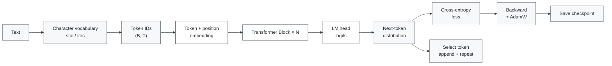
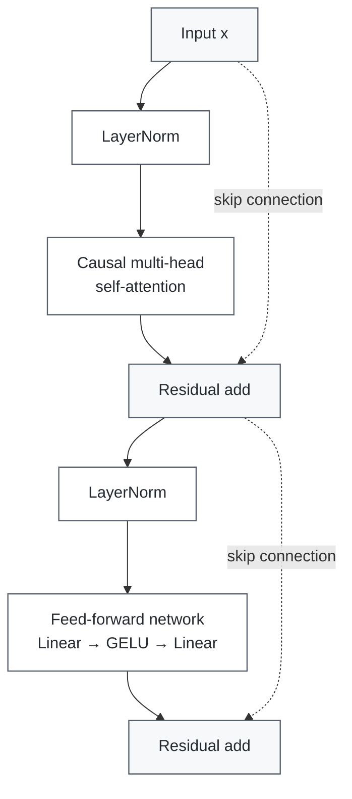

# Mini Transformer

[中文](README.md) | **English**

A small, from-scratch Mini GPT project for understanding how a Transformer works internally. The implementation starts with tensor operations, QKV projections, causal masking, and multi-head attention, then builds a complete character-level language-model training and generation pipeline.

## Contents

- [Overview](#overview)
- [Project Goals](#project-goals)
- [Project Structure](#project-structure)
- [Model Data Flow](#model-data-flow)
- [Architecture Diagram](#architecture-diagram)
- [Requirements](#requirements)
- [Installation](#installation)
- [Running the Experiments](#running-the-experiments)
- [Training and Generation](#training-and-generation)
- [Checkpoints](#checkpoints)
- [Learning Notes](#learning-notes)
- [License](#license)

## Overview

This repository is a hands-on learning project. It prioritizes readable tensor operations over production abstractions, so the core attention, feed-forward, residual, and normalization steps remain easy to inspect.

The final model is intentionally tiny. It trains on a small Chinese character corpus and is designed to validate the mechanics of next-token prediction, not to provide useful general-purpose language generation.

## Project Goals

- Inspect the tensor shapes and data flow inside a Transformer.
- Understand Q/K/V projections and scaled dot-product attention.
- Understand causal masking, multi-head attention, residual connections, LayerNorm, and GELU.
- Train a minimal character-level language model from scratch.
- Load the learned parameters and generate text autoregressively.

## Project Structure

| File | Description |
| --- | --- |
| `01_tensor.py` | Tensor operations and linear transformations |
| `02_qkv.py` | Q/K/V projections and attention scores |
| `03_train_qkv.py` | A minimal optimization experiment for QKV parameters |
| `04_causal_mask.py` | Preventing each position from seeing future tokens |
| `05_multi_head.py` | Splitting and merging multiple attention heads |
| `06_transformer_block.py` | LayerNorm, attention, residual paths, and FFN |
| `07_embedding.py` | Token and positional embeddings |
| `08_mini_gpt.py` | A single-file teaching demonstration of Mini GPT |
| `09_train.py` | Character-level next-token training |
| `10_generate.py` | Checkpoint loading and autoregressive generation |
| `mini_gpt_model.py` | Reusable MiniGPT, attention, FFN, and block definitions |
| `gpu_test.py` | CUDA availability and device checks |

## Model Data Flow



The default training configuration in `09_train.py` is:

- `d_model=32`
- `num_heads=4`
- `hidden_dim=128`
- `num_layers=2`
- `context_length=16`

These values are chosen for fast, inspectable experiments and are not intended as production-model settings.

## Transformer Block



The first diagram shows the end-to-end path from text input to training and autoregressive generation. The second diagram expands one Transformer block and makes both residual paths explicit.

## Requirements

- Python `>=3.12`
- PyTorch `>=2.14.1`
- NumPy `>=2.5.2`
- `uv` is recommended for reproducing the locked environment.

If CUDA is available, the scripts automatically use the GPU; otherwise, they fall back to the CPU. The project includes a CUDA 12.6 PyTorch index configuration. For CPU-only environments, install a platform-compatible PyTorch build.

## Installation

Using `uv`:

```bash
uv sync
```

Or create a regular Python virtual environment:

```bash
python -m venv .venv
source .venv/bin/activate       # Windows PowerShell: .venv\Scripts\activate
python -m pip install -U pip
python -m pip install numpy torch
```

## Running the Experiments

Run the introductory experiments in order:

```bash
python 01_tensor.py
python 02_qkv.py
python 04_causal_mask.py
python 05_multi_head.py
python 06_transformer_block.py
python 07_embedding.py
python 08_mini_gpt.py
```

## Training and Generation

Train the character-level Mini GPT:

```bash
python 09_train.py
```

The number of training steps can be changed with the `STEPS` environment variable:

```bash
STEPS=600 python 09_train.py        # Linux/macOS
$env:STEPS=600; python 09_train.py # PowerShell
```

Generate text from a trained checkpoint:

```bash
python 10_generate.py --prompt "我喜欢" --tokens 24
python 10_generate.py --prompt "我喜欢" --tokens 24 --sample --temperature 0.8 --top-k 3
```

The prompt must contain characters included in the training vocabulary. Because the corpus is intentionally tiny, generated text is only a demonstration of the inference pipeline.

## Checkpoints

Generated model checkpoints are ignored by Git. Running `09_train.py` creates:

```text
checkpoints/mini_gpt.pt
```

Run training before running `10_generate.py` after cloning the repository. Keeping checkpoints out of version control avoids mixing local experiment artifacts with source code and makes the reproduction path explicit.

## Learning Notes

This repository documents a step-by-step implementation of the Transformer mechanism. It intentionally omits a full tokenizer, large-scale data pipeline, distributed training, and production configuration management so that the core tensor operations remain visible.

## License

No open-source license has been selected yet. Add a license such as MIT or Apache-2.0 if you want to define how others may use, modify, and redistribute this code.
