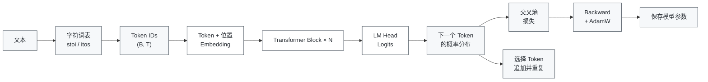
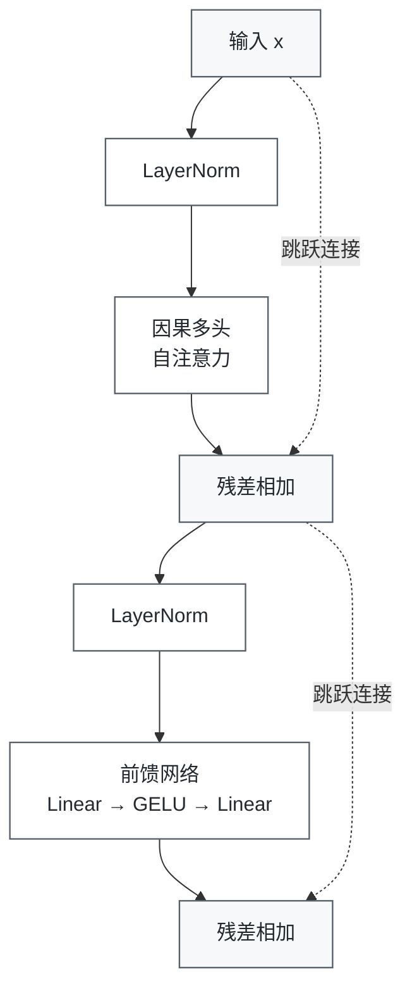

# Mini Transformer

**中文** | [English](README.en.md)

一个用于理解 Transformer 内部机制的手写 Mini GPT 项目。实现从张量运算、QKV 投影、因果掩码和多头注意力开始，逐步构建出完整的字符级语言模型训练与生成流程。

## 目录

- [项目概览](#项目概览)
- [项目目标](#项目目标)
- [项目结构](#项目结构)
- [模型数据流](#模型数据流)
- [结构图](#结构图)
- [环境要求](#环境要求)
- [安装](#安装)
- [运行实验](#运行实验)
- [训练与生成](#训练与生成)
- [模型文件](#模型文件)
- [学习记录](#学习记录)
- [许可证](#许可证)

## 项目概览

这是一个以学习为目的的实践项目。代码优先保证张量运算清晰可读，因此注意力、前馈网络、残差连接和归一化等核心步骤都可以直接观察。

最终模型规模很小，使用少量中文字符语料进行训练，目标是验证 next-token prediction 的机制，而不是提供通用的语言生成能力。

## 项目目标

- 观察 Transformer 内部的张量形状和数据流。
- 理解 Q/K/V 投影和缩放点积注意力。
- 理解因果掩码、多头注意力、残差连接、LayerNorm 和 GELU。
- 从零训练一个最小字符级语言模型。
- 加载训练参数并进行自回归文本生成。

## 项目结构

| 文件 | 说明 |
| --- | --- |
| `01_tensor.py` | 张量运算与线性变换 |
| `02_qkv.py` | Q/K/V 投影与注意力分数 |
| `03_train_qkv.py` | QKV 参数的最小优化实验 |
| `04_causal_mask.py` | 防止当前位置看到未来 token |
| `05_multi_head.py` | 多头注意力的拆分与合并 |
| `06_transformer_block.py` | LayerNorm、注意力、残差路径和 FFN |
| `07_embedding.py` | Token embedding 与位置 embedding |
| `08_mini_gpt.py` | 单文件 Mini GPT 教学演示 |
| `09_train.py` | 字符级 next-token 训练 |
| `10_generate.py` | 加载 checkpoint 并自回归生成 |
| `mini_gpt_model.py` | MiniGPT、注意力、FFN 和 Block 定义 |
| `gpu_test.py` | CUDA 可用性与设备检查 |

## 模型数据流



`09_train.py` 的默认训练配置为：

- `d_model=32`
- `num_heads=4`
- `hidden_dim=128`
- `num_layers=2`
- `context_length=16`

这些参数是为了快速实验和观察张量，不代表生产模型配置。

## Transformer Block



第一张图展示从文本输入到训练和自回归生成的完整路径；第二张图展开单个 Transformer block，并明确标出两条残差路径。

## 环境要求

- Python `>=3.12`
- PyTorch `>=2.14.1`
- NumPy `>=2.5.2`
- 推荐使用 `uv` 复现锁定的依赖环境。

如果 CUDA 可用，脚本会自动使用 GPU，否则回退到 CPU。项目包含 CUDA 12.6 的 PyTorch 源配置；仅使用 CPU 时，请根据平台安装兼容的 PyTorch 版本。

## 安装

使用 `uv`：

```bash
uv sync
```

或者创建普通 Python 虚拟环境：

```bash
python -m venv .venv
source .venv/bin/activate       # Windows PowerShell: .venv\Scripts\activate
python -m pip install -U pip
python -m pip install numpy torch
```

## 运行实验

按顺序运行基础实验：

```bash
python 01_tensor.py
python 02_qkv.py
python 04_causal_mask.py
python 05_multi_head.py
python 06_transformer_block.py
python 07_embedding.py
python 08_mini_gpt.py
```

## 训练与生成

训练字符级 Mini GPT：

```bash
python 09_train.py
```

可以通过 `STEPS` 环境变量调整训练步数：

```bash
STEPS=600 python 09_train.py        # Linux/macOS
$env:STEPS=600; python 09_train.py # PowerShell
```

使用训练好的 checkpoint 生成文本：

```bash
python 10_generate.py --prompt "我喜欢" --tokens 24
python 10_generate.py --prompt "我喜欢" --tokens 24 --sample --temperature 0.8 --top-k 3
```

提示词必须只包含训练词表中的字符。由于语料非常小，生成结果主要用于验证推理流程。

## 模型文件

训练生成的模型 checkpoint 默认被 Git 忽略。运行 `09_train.py` 后会生成：

```text
checkpoints/mini_gpt.pt
```

克隆仓库后，需要先训练，再运行 `10_generate.py`。不把 checkpoint 放进版本控制，可以避免把本地实验产物和源码混在一起，也能让复现实验的路径更清晰。

## 学习记录

这个仓库记录了我对 Transformer 机制的逐步拆解和实现。项目有意不包含完整 tokenizer、大规模数据管道、分布式训练和生产级配置系统，以便保留核心张量运算的可见性。

## 许可证

当前还没有选择开源许可证。如果希望明确其他人如何使用、修改和分发代码，可以添加 MIT 或 Apache-2.0 等许可证。
